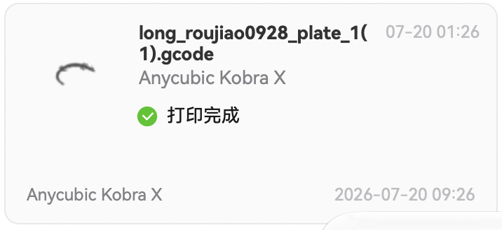
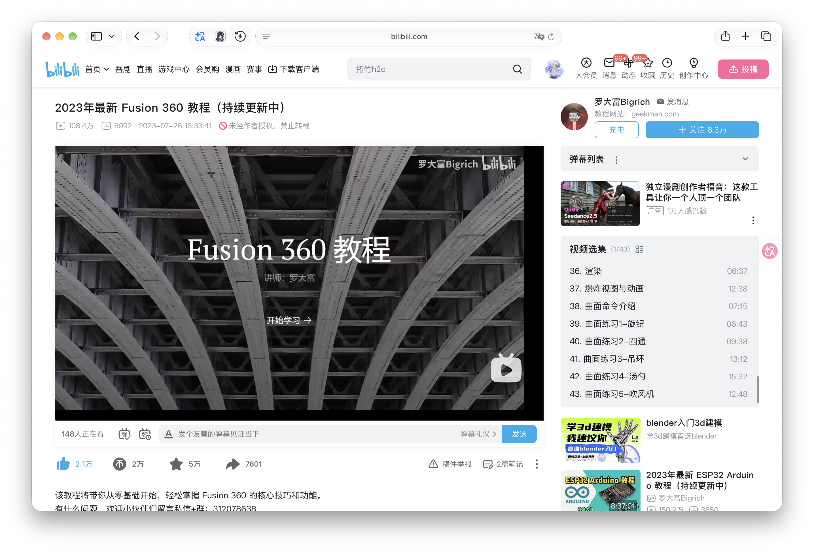
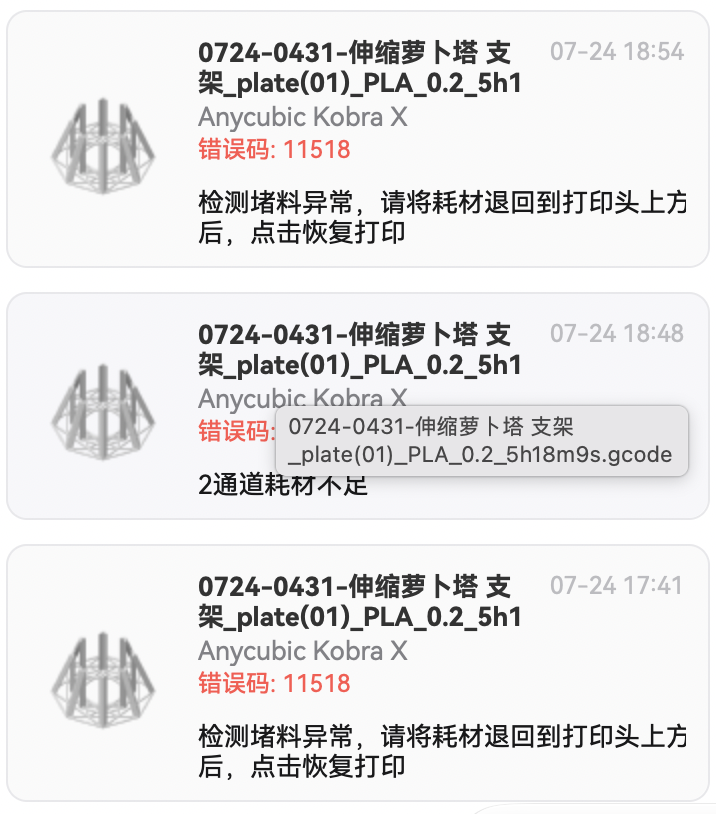
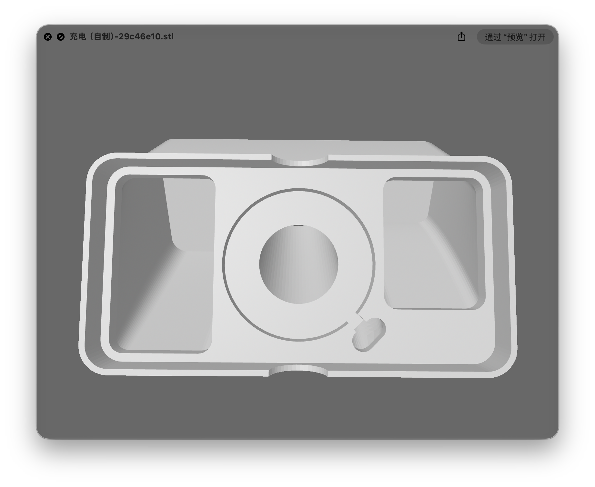
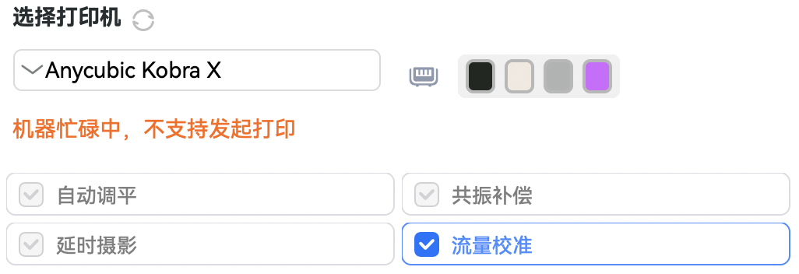

## 開始列印前

2026年，七月中旬，暑假，剛完成轉系到了新的學院，作為新升大二的小登，暑假的生活是非常悠閒的，這個三分鐘熱度又很容易衝動購物的傢伙誤打誤撞踏入了一個新的領域：3D列印

對於3D列印新手來說選擇的肯定是FDM印表機，一則對於新手來說FDM的精度已經足夠，二則我可不想被光固化的各種試劑毒死

在嗶哩嗶哩刷了幾天影片，我從拓竹A1、創想三維i7、縱維立方kx之間選擇了縱維立方kx，大概原因是實現多色列印的成本是這三套方案裡面最低的

## 初嘗試

2026-7-20，簽收了快遞，列印的第一個模型是「3D列印龍」，也算是一個比較經典的模型吧，利用了3D列印的自組裝特性

隨後的幾天我嘗試了為料盤架設計固定在椅背的方式，當然最終放棄了這個方案。我最初嘗試使用gpt5.6sol建模，在被氣到破防若干次後，我前往了嗶哩嗶哩打算學習建模

## 建模

對於一個完全新手來說，學習建模的第一步當然是選擇軟體啦。我最初嘗試了我唯一聽過的建模軟體（當時）：blender。這是一個開源軟體，但最大的問題是我建模的目的是設計一些工程測試件而非一些美術上的建模，所以對我來說不是非常適合。solidworks據說很強但我主要使用的是macbook，所以也作罷了。最終我選擇了學生免費（好文明！）的fusion作為我的建模啟蒙。跟隨這位嗶哩嗶哩up：https://www.bilibili.com/video/BV1xX4y1E7nG/?spm_id_from=333.788.videopod.episodes&vd_source=ccc9945c4f1f3370dd60b4bd9d2429a6 的影片算是比較系統地學習了fusion建模，邊看邊學，當然作者因為當時對曲面建模沒有需求所以只學到了裝配體部分

其間博主建模並列印了一些小玩意來檢驗自己的學習成果

## BUG

😠縱維立方套餐裡面的白色PLA耗材有問題，每次列印到一半會報錯堵頭😠，嘗試了好久各種解決方法，最終寄回去了讓他們寄了一卷灰色的回來。這BYD機器列印除了這一卷官方的白色PLA外都沒有出現這種情況😡

## 多色列印初嘗試

2026-7-21，嘗試列印超時空輝夜姬的蛞蝓模型，因為當時不知道可以直接用建模軟體打開\*.3mf檔案然後編輯參數、切片，所以手動匯入了STL然後手動上色，十分痛苦而且效果不是很好，後來才知道可以直接打開\*.3mf檔案並修改參數、切片

## 手機支架Project

刷嗶哩嗶哩看上了一個適配iPhone無線充電的手機充電支架專案，去makerworld找到了相應的專案，但是對應的卻是較新的iPhone和我的iPhone SE3不適配，於是嘗試讓gpt5.6sol幫我改模型，改了好幾版還是尺寸不符合，最終自己建模了一個差不多的

## 自建材料與工藝預設

除了上面提到的一些專案外，我還列印了很多其他東西，慢慢對列印速度不滿並開始嘗試如何提速並完善相關預設

首先我嘗試複用我使用的耗材廠商的官方配置（大簡），後來發現這份配置非常不完善也問題很多，最終嘗試廣泛參考拓竹、縱維立方的一些配置嘗試自己的PETG配置

當然在這個過程中廣泛使用了ai工具輔助

在進行了很多嘗試後我最終得到了比較完善的配置，將加速度提高到了機型的上限、並將流量提高到了約20mm^3/s

### 在嘗試過程中踩過的一些坑稍作總結如下（縱維立方的官方切片軟體基於OrcaSlicer）：

1. 立方填充切片更快，高速實打卻會撞到已列印的填充。立方填充是一種強度較高的填充，列印速度（切片時間）也較快，但是在高速列印的工況下噴嘴會撞擊當層填充中已經列印好的部分把填充撞得稀巴爛，所以比較推薦的配置是選用螺旋體或者類似的填充方式保證噴嘴不會撞擊填充

2. 工藝調整中的速度選項實際上並不總是能達到，最高速度實際上取決於耗材的流量，同時加速到最高速度通常需要若干公分的長度（取決於印表機設定中設定的加速度）

3. 「填充多線 2」沒有簡單地讓填充更結實，反而擴大了稀疏填充頂層跨度，從而限制了最低的填充密度（稀疏填充頂面跨度過大頂層實心填充將面臨過大的橋接，所以需要增大填充密度來減少該跨度）

4. 列印流量測試塔時一定要選用生產環境使用的線寬，同時得到的最大流量最好乘以一個係數（比如0.8）來使用確保穩定

5. 擠出倍率的測定較為麻煩，設置錯誤又會造成很嚴重的層紋不穩定問題，推薦使用切片軟體的流量校準功能

6. 列印的時候選擇調平有bug，建議列印前做一次調平，列印首層驗證後以後列印的時候不要打開調平開關

7. 改層數不一定真的生效。實際上底層和頂層的實心層的數量還同時取決於設置的最低厚度，實際取值不低於頂殼厚度對應的層數

8. PETG＋PLA 異料支撐容易拆，也會帶來黏接困難。特別是你嘗試直接在構建板使用一兩層PLA作為筏層時，PETG，特別是支撐，幾乎黏不住

9. 配置寫「前三層不吹風」，機器仍可能滿速吹，實測在使用異料支撐時穩定復現，疑似為機器的BUG

10. 床溫要同時考慮附著和取件，冷卻也不是萬能解法，只要可以黏住列印件，溫度可以越低越好

11. 通用預設負責常用基線，具體模型的問題單獨處理。比如填充密度、牆層數、頂、底層數都要根據實際情況調整

12. PETG和列印板黏合較緊密，可以考慮不使用brim降低拆模型的難度

### 異料支撐的一些設置要點

1. 支撐類型按照實際情況選擇樹狀或者普通

2. 支撐主體材料自動，隨 PETG 模型使用 PETG（或隨PLA選擇PLA）

3. 接觸介面材料選擇和模型主體不同的材料（記得先在耗材絲添加新的材料）

4. 頂部/底部接觸層數都是兩層

5. 頂部/底部介面線距都是0mm，形成實心介面

6. 頂部/底部Z間隙都是0mm，接觸閥層直接和模型、支撐接觸提升黏接強度

7. 介面材料用於支撐主體關閉，異種材料使用範圍限制在接觸介面

8. 筏層0層，閥層是直接鋪在列印板上的層，和支撐無關，反而會在一些模型與列印板接觸面積較小的地方造成黏結不足從而不黏板

9. 支撐與模型 XY 間距、支撐首層與模型間距：適當留0.xmm防止黏在一起

10. 僅從熱床生成支撐：根據實際情況開啟

**這些設置的意圖是讓介面貼住模型、減少底面懸空，同時利用 PLA 與 PETG 的材料差異方便拆除**

#### 擦料塔和沖刷方面

**因為異料支撐沖刷不乾淨很容易造成支撐面附近的Z軸強度過度降低，所以建議盡可能地增大沖刷和擦料**

先寫到這裡吧，什麼時候心血來潮接著寫喵～
