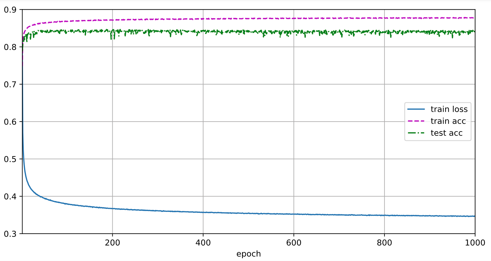
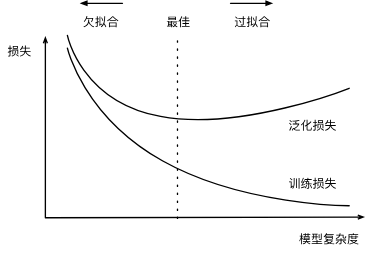
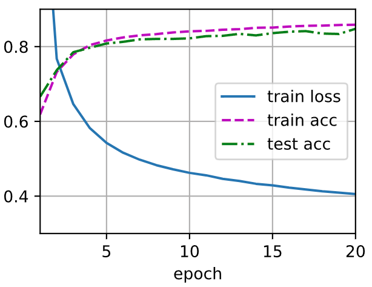
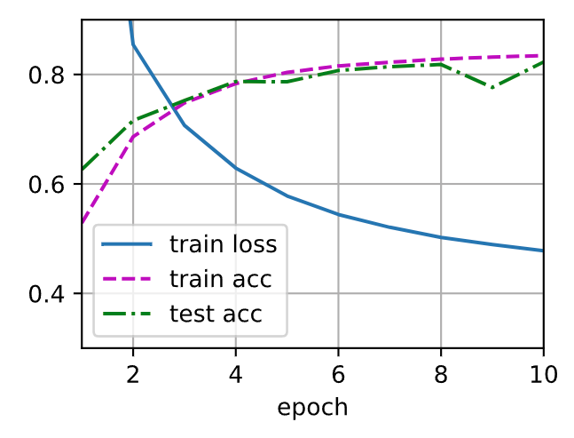
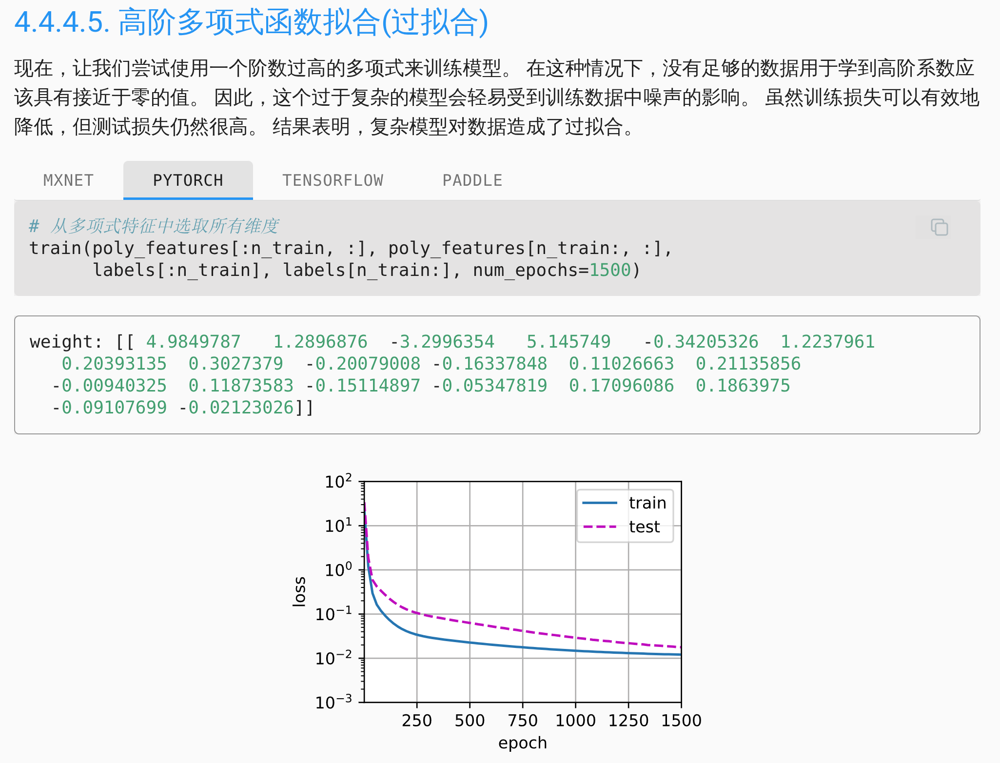
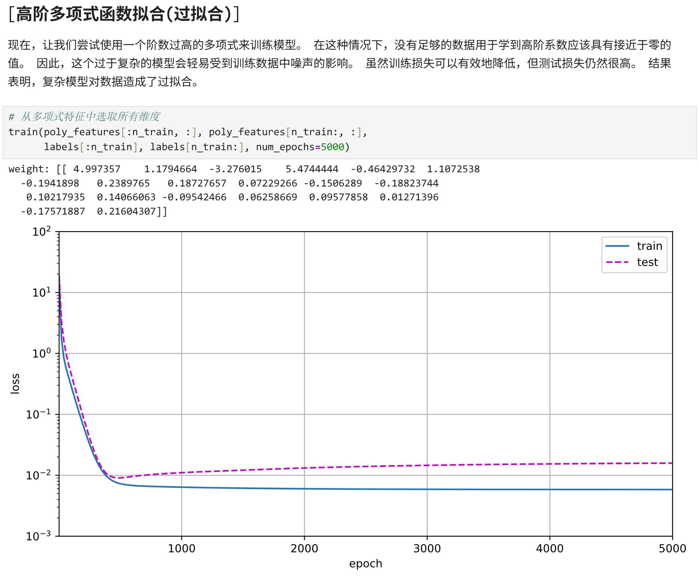

title: D2L Learning Notes
description: D2L Learning Notes

date: 2026-04-20T14:23:30+08:00
lastmod: 2026-05-06T12:00:00+08:00

categories:
  - d2l
tags:
  - d2l
  - PyTorch
  - Neural Networks
  - Deep Learning

math: true
---

## Learning Environment Startup Reminder

Remember to mount the disk `WORK`
```shell
cd /run/media/rmqg/WORK/learnDeepLearning/d2l-zh/d2l-zh/pytorch/
conda activate d2l
jupyter lab
```

## 2. Preliminaries & 3. Linear Neural Networks

The tutorial starts from `linear regression` and `softmax` regression, introducing the foundational methods for training models, including the following basic concepts:

- `Training set`: Data used for the model to learn from
- `Test set`: Data used to evaluate the model's generalization ability
- `Feature`: Information fed into the model, such as pixel values and numerical attributes
- `Label`: The ground-truth answer corresponding to a sample
- `Sample`: A single data instance in the dataset
- `Model`: A function or computational process that maps inputs to outputs
- `Parameter`: Quantities in the model that need to be learned through training, such as weights and biases
- `Batch size`: The number of samples fed into the model per training step
- `Epoch`: The process of making one complete pass through the entire training set
- `Forward propagation`: The process by which input data passes through the model to produce a prediction
- `Loss function`: A function that measures the discrepancy between the model's predictions and the true labels
- `Accuracy`: The proportion of correctly predicted samples in a classification task
- `Gradient`: The sensitivity of the loss function to changes in the parameters
- `Backpropagation`: The process of computing the gradient of each parameter based on the loss
- `Optimizer`: The method used to update model parameters based on gradients
- `Gradient descent`: The most common parameter update strategy, adjusting parameters in the direction that reduces the loss
- `Learning rate`: A hyperparameter that controls the step size of each parameter update
- `Generalization`: The model's ability to perform well on data it has not seen before

Along with actual code, the tutorial presents the basic procedure for training a model:

- Iterate over the entire training set
- Forward propagation
- Compute the loss
- Backpropagation
- Update the parameters
- Record the training loss and training accuracy for this epoch

### Difference Between "Concise Implementation" and "Implementation from Scratch"

Compared to the from-scratch implementation of softmax regression in the previous section, the "concise implementation" in this section does not change the essence of the model — it still flattens the input image, passes it through a single fully connected layer to output scores for 10 classes, and uses cross-entropy loss for training. The main difference lies in the implementation approach:

In the from-scratch implementation, you need to manually define the model parameters `W` and `b`, write the `softmax` function, the cross-entropy loss function, and the parameter update procedure yourself. The advantage of doing this is that it gives you a clearer understanding of the mathematical principles and training workflow behind softmax regression — for example, what forward propagation, loss computation, backpropagation, and gradient descent are each doing.

In the concise implementation, most of these low-level details are handled by PyTorch's high-level APIs. For example, `nn.Flatten()` is used to automatically flatten the input image, `nn.Linear(784, 10)` automatically defines the linear layer and its parameters, `nn.CrossEntropyLoss()` directly computes the loss for a multi-class classification task, and `torch.optim.SGD` handles the parameter updates. This results in shorter, more standardized code that is also more consistent with common practices in real-world engineering.

In addition, the concise implementation has one important advantage over the hand-written version: better numerical stability. When implementing from scratch following the mathematical definition directly, you may encounter issues such as exponential overflow or underflow when computing softmax and cross-entropy; frameworks typically have already optimized for these cases internally, making them safer and more reliable in practice.

> [!NOTE]
> The concise implementation hides the implementation details of `d2l.train_ch3` and the functions it calls; it is presumed that they should be consistent with the identically named functions in the from-scratch implementation.

> [!WARNING]
> Exercise 3.7.6 appears to have the following issue: increasing the number of epochs does not cause test accuracy to decrease after a period of time — instead, it stabilizes near an upper bound.



The presumed reason is that `softmax` regression is essentially a linear model with an inherent upper limit on its expressive capacity. The model has only about `7850` parameters (784×10 + 10), and faced with `60000` training samples, the number of parameters is far too small to "memorize" the training data. Therefore, no matter how many epochs are trained, the model cannot truly overfit — it is stuck in `underfitting` rather than `overfitting`. Both training accuracy and test accuracy will eventually converge and stabilize near an upper bound (around 85%), with the gap between the two remaining consistently small.

The emergence of overfitting requires the model to have sufficient capacity to fit the noise in the training set, and a linear classifier simply does not possess this capability for nonlinear tasks such as image classification. The premise of this exercise in the textbook ("test accuracy will decrease after a period of time") is more appropriate for describing models with more parameters and stronger expressive power, such as multilayer perceptrons or convolutional neural networks trained on small datasets.

## 4. Multilayer Perceptrons

### Basic Concepts

- `Deep neural network (DNN)`: A neural network with many hidden layers
- `Anti-monotonicity`: Causes the limitation of linear model fitting
- `Starting point for designing nonlinear models`: When representing data, we consider the correlated interactions between features; building a linear model on top of such representations may be appropriate
- `Hidden layer`: One or more hidden layers are added to the network to overcome the limitations of linear models, enabling it to handle more general types of functional relationships
- `Multilayer perceptron (MLP)`: Stacks many fully connected layers together. Each layer outputs to the layer above it until the final output is produced. The first L-1 layers are viewed as representations, and the last layer as a linear predictor
- `Nonlinear activation function`: Applied to each hidden unit after the affine transformation, preventing the `multilayer perceptron` from degenerating into a `linear model`
- `Universal approximation theorem`: In theory, a `single-hidden-layer network` can learn any function, but by using `deeper` (rather than `wider`) networks, we can more easily approximate many functions
- `Activation function`: Determines whether a neuron should be activated by computing a weighted sum and adding a bias; they are differentiable operations that transform input signals into outputs
  - `ReLU function`: $\text{ReLU}(x) = \max(x,\, 0)$
  - `Sigmoid function (squashing function)`: $\sigma(x) = \dfrac{1}{1 + e^{-x}}$
  - `tanh (hyperbolic tangent) function`: $\tanh(x) = \dfrac{e^x - e^{-x}}{e^x + e^{-x}}$
- `Overfitting`: The phenomenon where a model fits the training data more closely than it fits the underlying distribution
- `Regularization`: Techniques used to combat overfitting
- `Training error`: The error computed by the model on the training dataset
- `Generalization error`: The expected model error when the model is applied to infinitely many data samples drawn from the same distribution as the original samples
- `Independent and identically distributed (i.i.d.) assumption`: Assumes that both `training data` and `test data` are drawn independently from the same distribution. In practice, however, almost all real-world applications involve at least some violation of the i.i.d. assumption

> Several factors that tend to affect model generalization:
> The number of tunable parameters. When the number of tunable parameters (sometimes called degrees of freedom) is large, models tend to overfit more easily.
> The values taken by the parameters. When the range of weight values is large, models may be more prone to overfitting.
> The number of training samples. Even a simple model can easily overfit a dataset containing only one or two samples. Overfitting a dataset with millions of samples, on the other hand, requires an extremely flexible model.

- `Model selection`: Selecting the final model after evaluating several candidate models, such as:
  - Models that are fundamentally different in nature, such as decision trees versus linear models
  - The same class of model under different hyperparameter settings, which may involve the use of a `validation set`
- `Validation set`: In principle, we do not want to use the `test set` until all `hyperparameters` have been determined, in order to avoid overfitting the `test data`; nor can we rely solely on `training data` to select the model, because we cannot estimate the `generalization error` on `training data`. Therefore, the common practice is to split our data into three parts: in addition to the `training and test datasets`, a `validation dataset` (also called a `validation set`) is added
- `K-fold cross-validation`: The original training data is split into $K$ non-overlapping subsets. Model training and validation are then performed $K$ times; each time, training is done on $K-1$ subsets and validation is done on the remaining one subset (the subset not used for training in that round). Finally, the training and validation errors are estimated by averaging the results across the $K$ experiments

#### Overfitting and Underfitting

- `Underfitting`: The generalization error between our `training` and `validation` errors is small, but both are severe; there is reason to believe that a more complex model could `reduce the training error`
- `Overfitting`: The `training error` is significantly lower than the `validation error`

Whether overfitting or underfitting occurs may depend on model complexity and the size of the available training dataset.

`Model complexity`:



`Dataset size`: The fewer samples in the training dataset, the more likely (and more severely) we are to overfit. Given more data, we might try to fit a more complex model (which gave rise to `deep learning`).

### Challenges

Jointly optimizing hyperparameters such as:

- Learning rate
- Number of training epochs
- Number of hidden layers
- Number of hidden units per layer

to find the optimal or near-optimal solution is difficult, and the hyperparameters are not independent of one another — they interact with each other. `Hyperparameter optimization` is a high-dimensional search problem; brute-force training is extremely costly.

Strategies:

- `Staged search`:
  - First fix a relatively simple model architecture and tune `batch size`
  - Search for the `learning rate`
  - Then, near the better learning rate, search for the `number of hidden units`
  - Then compare `number of hidden layers`
  - Finally, fine-tune the `number of training epochs`
- `Coarse-to-fine search`:
  - First use sparser candidate values for a coarse search
  - Identify the roughly optimal region, then perform a fine search nearby
- `Random search`: Try your luck
- `Early stopping`: If the results look terrible early on, stop and switch hyperparameters
- Check the validation set first rather than using the test set directly, to avoid the test set also `overfitting` (d2l at this point only has a training set and a test set, so this does not need attention for now)

When working on `Exercise 4.3 Concise Implementation of Multilayer Perceptrons`, the author used hyperparameters of `batch size` 256, `lr` 0.03, `hidden units` 1024, `hidden layers` 1, and `epochs` 20, achieving the following training results:



## Random Musings

Why does the `test acc` curve have a mysterious dip at this particular point?



> [!CAUTION]
> Becoming an excellent machine learning scientist requires the ability to think critically.

Why does the overfitting the textbook produces look different from what I get? 🤔





---

## Study Notes for 2026-06-05

Roughly covered some content on CNN and modern CNNs.

D2L's explanations in this section are noticeably much more cursory than in the earlier chapters, with many things left only superficially understood.

It should mainly serve as a knowledge reserve to draw upon when needed in the future.
