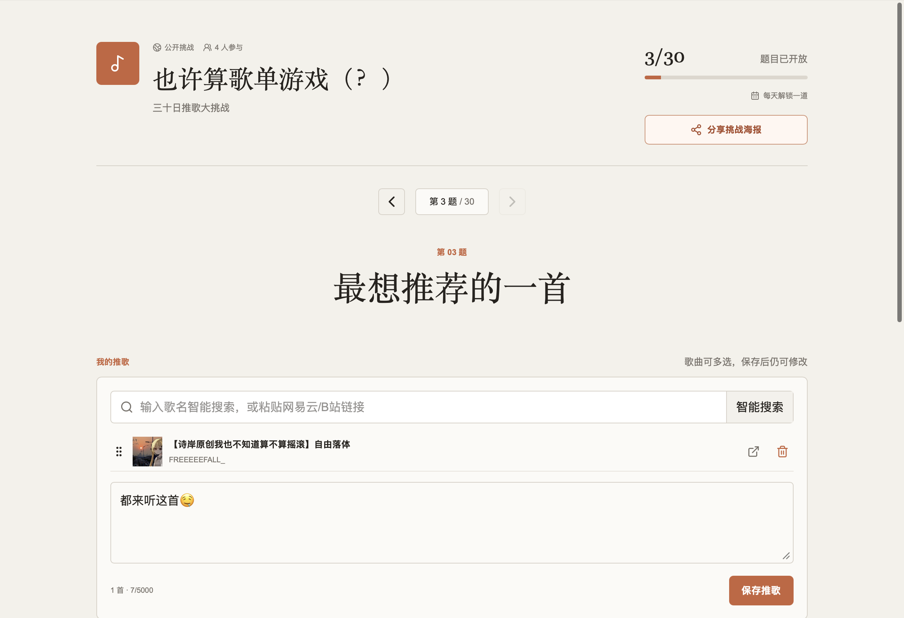

先日、グループチャットで「30日推し曲大チャレンジ」のアンケート画像を見かけました。そのとき、この手の遊び方を単なる1枚の画像で終わらせてしまうのはもったいないとふと思ったのです。もし誰もが実際に曲を選び、誰かのおすすめを聴き、いいねやコメントを送り合い、その記録を残していけるなら、それはまるで途切れることなく続く小さな音楽交換会のようになるのではないか、と。

そうして生まれたのが **推し曲チャレンジ** です。





## 固定の30問アンケートではない

最初の画像はあくまで一例に過ぎず、いわゆる「定番問題集」でもなければ、サイトのデフォルトコンテンツでもありません。新規チャレンジの問題集はデフォルトで空になっており、作成者は好きな数だけ自分で問題を書くことも、30問のサンプルを読み込むことも、あるいはすでにあるアンケート画像をそのままアップロードして、ビジョンモデルに編集可能な問題リストとして認識させることもできます。

問題は一括で全問公開することも、1日1問ずつ公開することも可能です。日ごとの公開タイミングは一律で北京時間を基準に計算され、トップページには現在すでに公開されていて、かつ自分がまだ回答していないチャレンジのみが表示されます。すでに回答し終えた項目がToDoエリアを占有し続けることはありません。

## 曲で回答し、曲を通じて交流する

各問題には1曲または複数曲を選択し、感想を添えることができます。現在はBilibili動画とNetEase Cloud Musicの楽曲リンクに対応しており、他の参加者は元のページを直接再生したり、いいねやコメントを付けたりできます。

また、元のアンケートにあった面白い「イメージ曲」の遊び方も残しました。コミュニティの仲間にキーワードを投げかけ、相手がその言葉に合った曲を1つ選ぶというものです。関連するインタラクションはサイト内通知で届けられ、該当する問題と回答へ正確にジャンプできます。

公開チャレンジは「広場」で見つけることができます。Tokenチャレンジでは6桁の数字による招待コードを使用します。シェア用ポスターには最大3列・30問がQRコード付きで一覧表示され、TokenチャレンジのQRコードには招待情報を直接含めることができます。

## 「スマート検索」はいかにして本家を探し出すか

曲名のみが入力された場合、サーバー側はBilibiliの検索結果から最初の3ページ・最大50件の実際の検索結果を取得し、タイトル、投稿者、概要欄、投稿日時などの根拠をモデルに渡して絞り込みを行います。モデルは書き間違いを起こしやすいBV番号を直接出力せず、候補のインデックス番号のみを返し、実際のリンクはサーバー側が補完します。

絞り込み結果には、オリジナル本家、歌ってみた（カバー）、公式リメイク、二次創作などの構造化された分類が含まれます。再生数は補助的な根拠として参照されますが、タイトルやソース、投稿日時より優先されることはありません。成功した結果は正規化された曲名ごとに永続キャッシュされ、同じ曲に対して二度とモデルのトークンを消費することはありません。

## 実装と運用

本プロジェクトはNext.js 16、React 19、Better Auth、Drizzle ORM、PostgreSQL 17を採用し、Docker Compose上で稼働しています。画像問題集のテキスト起こしにはOpenRouterのビジョンモデルを経由し、曲名の絞り込みにはDeepSeekを使用しています。プラットフォームごとのロジックはすべてアダプターの背後に隠蔽・分離されています。

本番環境にはヘルスチェック、データベースバックアップ、各プラットフォームのCookieログイン状態監視、およびBarkによる切断・セッション切れ通知が含まれています。機密性の高い設定はサーバーのシークレットにのみ保持され、フロントエンドやログ、Gitリポジトリには一切入りません。

プロジェクトは **GPL-3.0-only** でオープンソースとして公開されています。現在のUIやルールも今後変化していくはずですが、少なくとも次にグループ内で推し曲アンケートが出回ったときには、実際にみんなで一緒に楽しめる場所ができました。

## オープンソース公開追記

**GitHub：** [rmqg/playlist-challenge](https://github.com/rmqg/playlist-challenge)

`playlist-challenge` は、完全なパブリックリポジトリとして [GitHub](https://github.com/rmqg/playlist-challenge) に公開されました。トップページはまず友人と一緒に推し曲を共有したい人向けに、問題の作り方、答え方、感想の交わし方を記載しており、後半にはセルフホスティング、デプロイ、コントリビューションへの案内も用意しています。

リポジトリには、GPL著作権表記およびサードパーティ通知、マスキング済みのデプロイテンプレート、コントリビューションおよびセキュリティポリシー、さらに型チェック、静的解析、テスト、本番ビルドを自動実行するCIが整備されています。プラットフォームのCookie、モデルのAPIキー、Barkの設定、運用データが公開リポジトリに含まれることはありません。

中国国外にある本番サーバーでの画像問題集の処理には、引き続きOpenRouterをデフォルトで使用しています（SiliconFlowサービスへの実際のアクセス結果が芳しくなかったため）。中国本土でデプロイし、対象サーバーからの遅延や安定性を各自で検証したい開発者向けに、リポジトリには別途[SiliconFlow SDK 設定リファレンス](https://github.com/rmqg/playlist-challenge/blob/main/docs/SILICONFLOW.md)も同梱しています。
