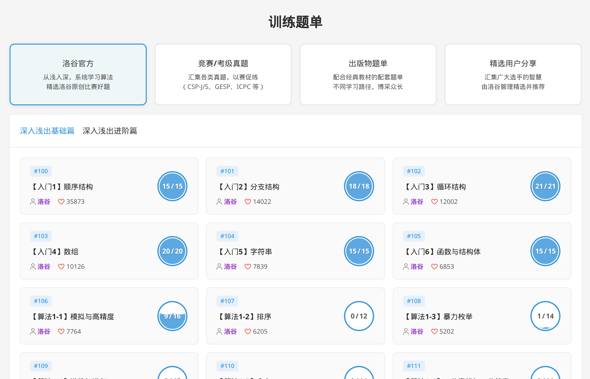
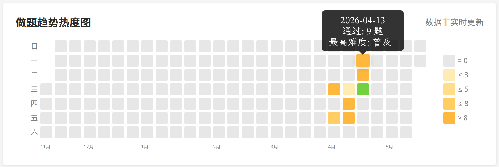

## Before Enrollment

Before starting university, I had basically no plan whatsoever about what I wanted to study or what I wanted to do in the future. I heard people say that the faculty in the Electronics and Information department at the East Campus was better than at the Zhuhai Micro Campus, so on a whim I decided to go to the School of Electronics and Information at the East Campus — at the time I didn't even know how to get there.

---

## First Semester of Year One

I suppose I was just carrying on the same study habits from high school, or you could say I'd been thoroughly brainwashed by my elders and high school teachers. I'd say I was extremely hardworking during my first year (at least in the month or two before finals). I drifted through the first semester in a haze — I tried to do a few things, but they all fizzled out due to my own laziness, things like **YSYX (One Student One Chip)** and attempting to learn guitar.

All in all, during the first half of the first semester of Year One, aside from assignments, I watched a few anime series, learned a little **YSYX** (where I actually gained more from the `Linux` and `CS` introductory aspects than from the main YSYX curriculum itself), and made my first attempt at building a `Blog`. In the second half of the semester, I suddenly realized that if I didn't study properly for finals I might fail, so I spent over a month reviewing **Calculus**, **University Physics**, and **Linear Algebra** very seriously.

I'd say the final results were pretty good — I happened to get `rank 1` at the Zhuhai Micro Campus, which gave me a certain advantage when it came to changing majors and applying for scholarships.

---

## Second Semester of Year One

The second semester of Year One was, if anything, even more of a slump than the first. Besides watching some anime, the things worth mentioning are probably: first, I spent a few hundred yuan buying a second-hand server to build a `NAS`, and spent quite a lot of time configuring the file system, setting up a local network, and doing intranet penetration. I also rebuilt `Blog Ver.2` (something went wrong with the `VPS` for the first version — I don't know why I didn't try to migrate the blog and instead built a new one from scratch, which again took up a lot of time).

But did any of this really mean anything? A lot of things that took enormous effort to build fall apart quickly once you stop maintaining them, and constantly maintaining things is itself exhausting.

Then, starting around May, I had a romantic relationship for a while. She was a girl from a student club — we first met at a club activity and chatted a lot on `QQ`. In the early hours of **May 12th**, I confessed my feelings, and she said yes. We were probably both quite immature, and there were large gaps in our values and outlook; except for a brief period at the very beginning, we didn't get along well. We eventually broke up on Valentine's Day 2026.

---

## The First Major Change

The preparation process for this transfer was actually very brief. When I received the major-change documents from the academic affairs system, my target was basically already narrowed down to either the School of Electronics or the School of Computer Science. Probably because I was in a relationship at the time ~~(though even now I'm not exactly free of that)~~, I wanted to prioritize being in the same campus (East Campus) as my girlfriend, so I chose the safer option: the School of Electronics.

The whole preparation process was quite relaxed. Given my sufficiently high GPA, I only prepared a brief English self-introduction before the interview, and successfully transferred into the School of Electronics.

Here is part of a chat log with `CandleST`:
```text
2025/05/05 17:44
Ruomu Qiuguang: By the way, I probably don't need to prepare much for the major transfer interview, right?
[Image]
CandleST: Not sure
CandleST: But knowing electronics + high GPA = you'll pass easily
Ruomu Qiuguang: Got it, meow~
Ruomu Qiuguang: 🌿

2025/05/10 09:41
Ruomu Qiuguang: Wait, this year only 77 people applied for the CS transfer preliminary exam
Ruomu Qiuguang: And it looks like they're accepting around 60
[Image]
Ruomu Qiuguang: Meow?
[Image]
Ruomu Qiuguang: The acceptance rate is nearly 80%
Ruomu Qiuguang: Even higher than the School of Electronics
CandleST: I don't have the desire to do it lol
CandleST: I've already decided to stay at Shenzhen

2025/05/10 12:57
[Image]

2025/05/22 08:06
Ruomu Qiuguang: [Image]
Ruomu Qiuguang: Hey!
Ruomu Qiuguang: I still can't figure out why I transferred to the School of Electronics instead of CS ()
Ruomu Qiuguang: I want to code 😭

2025/05/22 12:09
Ruomu Qiuguang: I basically just coasted in
Ruomu Qiuguang: I admire everyone who actually studied hard
Ruomu Qiuguang: Feels like it's been so long since I genuinely studied
Ruomu Qiuguang: I've been slacking off, meow~

2025/05/22 12:16
CandleST: [Unsupported element type] I coasted into Cyber Security too
CandleST: [Unsupported element type] Not really coasting
Ruomu Qiuguang: Okay okay okay
CandleST: GPA 4.19
CandleST: Passed easily
Ruomu Qiuguang: [Unsupported element type] Not exactly not coasting
Ruomu Qiuguang: I only looked at my self-introduction the night before the exam
Ruomu Qiuguang: The circuits and C questions on the exam basically almost gave me the answers directly
CandleST: [Unsupported element type] Unbeatable
CandleST: They really wanted you
Ruomu Qiuguang: Exactly
CandleST: /admire /admire
```

---

## First Semester of Year Two

And then I stumbled into Year Two. By some strange twist of fate I ended up selecting all the Year Two elective courses in the School of Electronics, also signed up for a minor at the School of Computer Science (a 2-credit lab course totaling 72 class hours), joined a large number of sports clubs, and spent a lot of time going on dates with my girlfriend.

The result was: **my grades, predictably, completely fell apart.**

First, there was a pile of unfinished assignments — I still owed quite a few for *Complex Functions and Mathematical Methods* even after the exams were over.

Second, my exam review was woefully incomplete. The time I had for final revision was squeezed to the absolute limit; for some courses I still hadn't memorized many basic concepts by the time I sat the exam, let alone being able to do calculations with any fluency.

The one lucky thing was probably joining `MSC`, which gave me the opportunity to meet the sharpest `CS` minds at Sun Yat-sen University and to get exposure to the most cutting-edge `CS` knowledge.

Perhaps it was deep disappointment with the School of Electronics' approach to education and its atmosphere, or perhaps a feeling that I was simply not suited to studying in the `EE` direction, or perhaps just a desire to escape from my inevitably disastrous grades — whatever the reason, before the final exams were even over I had begun to form a vague intention to change majors.

I started asking `CandleST`, the only person I knew at the time who had transferred into a `CS`-related program. They gave me a little information, a little courage, and a group chat: a group chat that brought together all the adventurers at Sun Yat-sen University who wanted to transfer into a `CS`-related field.

**December 13, 2025**, I discussed some matters about changing majors with `CandleST` and, at their invitation, joined the `2026 School of Computer Science Major Transfer Exchange Group (QQ Group: 476972628)`.
```text
2025/05/11 15:38
Ruomu Qiuguang: By the way, I'm kind of thinking about transferring down to the School of CS
Ruomu Qiuguang: The School of Electronics is too intense
Ruomu Qiuguang: And I'm not that interested either (
CandleST: CS is actually pretty intense too (?）
CandleST: [Unsupported element type] It's doable though
Ruomu Qiuguang: 🌿
CandleST: But would you have to drop a year?
Ruomu Qiuguang: That's what I'm worried about — postgrad prospects and employment
Ruomu Qiuguang: Sigh
Ruomu Qiuguang: [Unsupported element type] Yeah
Ruomu Qiuguang: Should be fine I guess
Ruomu Qiuguang: Anyway the economy isn't great right now, spending a few more years at school isn't a big deal
Ruomu Qiuguang: [Unsupported element type] 111111
Ruomu Qiuguang: Is the assessment the same for Year One and Year Two transfers?
CandleST: Both should be fine
CandleST: [Unsupported element type] Yes
Ruomu Qiuguang: If it's Calculus and Programming, that shouldn't be a problem?
Ruomu Qiuguang: Programming is definitely no problem
CandleST: [Unsupported element type] Yes
Ruomu Qiuguang: Calculus isn't hard either
CandleST: Your level, you can transfer easily
Ruomu Qiuguang: At least it's simpler than the stupid math and physics this semester
Ruomu Qiuguang: [Unsupported element type] My GPA in the Microelectronics track at the School of Electronics has dropped below the postgrad recommendation line
Ruomu Qiuguang: 😡
Ruomu Qiuguang: Who has a postgrad recommendation GPA cutoff of 3.7/4.0 😡
Ruomu Qiuguang: If I bomb Year Two Semester One I'll transfer (though that's basically a foregone conclusion lol
CandleST: [Unsupported element type] School of Medicine (?）
CandleST: [Unsupported element type] Don't worry
CandleST: You can do it
CandleST: Really
Ruomu Qiuguang: [Unsupported element type] School of Electronics (
[Image]
[Image]
CandleST: Scary

2025/05/13 08:22
Ruomu Qiuguang: Pretty much decided I'm going to transfer
Ruomu Qiuguang: Sigh, I'll have to pick Calculus back up
[Image]
Ruomu Qiuguang: By the way, do I need to retake Mathematical Analysis?
[Image]
[Image]
[Image]

2025/05/13 12:44
CandleST: [Unsupported element type] Probably

2025/05/13 12:46
[Image]
[Image]
[Image]

2025/05/13 17:37
Ruomu Qiuguang: By the way, don't you have a friend who transferred to the School of CS?
Ruomu Qiuguang: Could you introduce me? 😋
Ruomu Qiuguang: Thank you meow thank you meow
CandleST: More than one
CandleST: Just join the group directly
Ruomu Qiuguang: How come Yushu is in there too (
CandleST: Because he started out in PPE
Ruomu Qiuguang: What's PPE (
CandleST: Philosophy, Politics, and Economics — all in one
Ruomu Qiuguang: Didn't Yushu transfer to Biomedical Engineering? (
CandleST: [Unsupported element type] Right, so he ended up not going there
CandleST: But he's still in the group
Ruomu Qiuguang: 😮

2025/05/13 20:28
Ruomu Qiuguang: By the way, can I take courses at the School of CS as a minor and then convert those grades after I transfer?
[Image]
CandleST: You can
Ruomu Qiuguang: But isn't there a risk 🤔
Ruomu Qiuguang: What if I don't get in, then I'm done for (
CandleST: So that's why
CandleST: It's all in
Ruomu Qiuguang: Hello academic warning (
Ruomu Qiuguang: Has anyone actually done this? (

2025/05/13 20:57
Ruomu Qiuguang: Wait, Signals and Systems is also a required course for CS
Ruomu Qiuguang: But I took it as an elective in the School of Electronics
Ruomu Qiuguang: And I set it to P/NP
Ruomu Qiuguang: And now I can't even finish reviewing all my required major courses
[Image]
Ruomu Qiuguang: I'm done for
CandleST: Don't worry
Ruomu Qiuguang: Three weeks to review 20-something credits
[Image]
Ruomu Qiuguang: I slacked off too much before
Ruomu Qiuguang: Sigh
CandleST: [Unsupported element type] lol w
CandleST: Sigh
[Image]
Ruomu Qiuguang: This is exactly why I have to say
[Image]
CandleST: [Image]
```

I can only say that my understanding of academics and of changing majors at that point was still very shallow — even a bit absurd — but people are always improving, aren't they?

Even before my Year Two Semester One grades had come out, I had gradually steeled my resolve to change majors (because I knew I'd done terribly), though I still didn't know which `CS`-related school to aim for. At the time I was leaning toward the **School of Software Engineering**, because I'd heard its curriculum and internship opportunities were relatively more student-friendly compared to other schools.

**January 16, 2026**, right after the final exams ended, I took a trip to the Shenzhen Campus to look around — perhaps that visit was one of the reasons I ultimately chose the School of Cyber Security at the Shenzhen Campus.

My first impression of the Shenzhen Campus was that it was **vast and magnificent**. It had none of the cramped shabbiness of the South Campus or the oppressive exam-factory atmosphere of the East Campus. As Sun Yat-sen University's newest campus and the one with the most generous construction budget, it fulfilled, to a certain degree, my vision of what a top-tier university campus should look like: spacious classrooms and buildings, convenient facilities of all kinds, a grand and bright library, and a community of faculty and students studying or researching something with shared enthusiasm.

Though it certainly has its drawbacks — inconvenient food options, inconvenient transportation — for someone with the romantic sensibility of a science student, for someone like me who doesn't care much about food and prefers to hole up alone and tinker with things, it is actually a very good place to study and live.

---

## Winter Break

The predictably disastrous Year Two Semester One grades didn't have much impact on my winter break — which is to say, I remained thoroughly unproductive.

I scrolled through short videos for over a month. After **Terminus: Survival** launched, I played it day and night for several days. I didn't go home until close to the Lunar New Year, and even after getting home I didn't do anything productive — I was still immersed in the world of the internet.

Perhaps worth mentioning is that on **Valentine's Day 2026**, my girlfriend and I broke up due to various conflicts. Combined with my frustration over the many tedious lab reports required by the School of CS and my dissatisfaction with its intensely competitive atmosphere, I removed the School of CS from my list of candidate schools for the transfer.

**February 21, 2026**, I discussed the differences between several `CS`-related departments with `CandleST` again, and basically settled on the idea of transferring to the **School of Cyber Security**. I also joined the WeChat groups for prospective Cyber Security and Software Engineering transfers (I had actually been redirected into the CS transfer group as early as January 6th): since WeChat group join links expire, please message me privately if you need the current links for either group.
```text
2025/02/21 20:59
Ruomu Qiuguang: Poke poke
Ruomu Qiuguang: Senior, could you tell me if you have any recommendations among these CS-related schools?
Ruomu Qiuguang: I don't have any strong attachment to a specific direction
Ruomu Qiuguang: I'll most likely go on to postgrad
CandleST: [Unsupported element type] Looking at it now, CS is the best option
CandleST: Broad scope
Ruomu Qiuguang: But it's too competitive, ugh
[Image]
CandleST: [Unsupported element type] That's true
CandleST: Software Engineering and Cyber Security both have their downsides
Ruomu Qiuguang: Tell me more
CandleST: But slightly less competitive
CandleST: [Unsupported element type] There are quite a few
CandleST: Like Software Engineering doesn't offer all the courses, GPA inflation, and it's still very competitive
CandleST: Cyber Security requires you to take a bunch of security courses
Ruomu Qiuguang: Hmm
Ruomu Qiuguang: What about the others?
CandleST: Intelligent Science actually has a curriculum somewhat similar to Electronics (?）
CandleST: [Unsupported element type] What does mommy mean 💦💦💦
Ruomu Qiuguang: [Unsupported element type] Forget that then
Ruomu Qiuguang: [Unsupported element type] For example
Ruomu Qiuguang: Oh right, do you have any thoughts on location (campus)?
Ruomu Qiuguang: Did Cyber Security also switch to a 4-point scale in 2025?
Ruomu Qiuguang: Is there a group? (
CandleST: [Unsupported element type] No
Ruomu Qiuguang: Great then 😋
CandleST: [Unsupported element type] Guangzhou > Shenzhen > Zhuhai
Ruomu Qiuguang: Everyone competing on a 5-point GPA scale can go die 😋
Ruomu Qiuguang: Though my Digital Electronics bombed at only 2.8
[Image]
Ruomu Qiuguang: Even a perfect score on the Digital Electronics lab only gets you 4.0 😡
Ruomu Qiuguang: The School of Electronics is so underhanded
CandleST: [Unsupported element type] Retake it hard
Ruomu Qiuguang: I feel like I really could
Ruomu Qiuguang: That course doesn't really require much listening in class anyway
Ruomu Qiuguang: Just coast through it
Ruomu Qiuguang: I feel like during the exam something just went mysteriously wrong
(
[Image]
Ruomu Qiuguang: If I review properly for finals I can definitely get 3.x
Ruomu Qiuguang: [Unsupported element type] 111
CandleST: Cryptography
CandleST: Elementary Number Theory
CandleST: Abstract Algebra
CandleST: Privacy Sharing
Ruomu Qiuguang: A is 4
CandleST: Software/System Security
Ruomu Qiuguang: B+ is 3.8
Ruomu Qiuguang: B is 3.3
Ruomu Qiuguang: And so on
Ruomu Qiuguang: Roughly how many points do all of those add up to?
[Image]
[Image]
CandleST: What a terrifying tiered system
Ruomu Qiuguang: What a terrifying tiered system
Ruomu Qiuguang: I hate letter-grade systems so much
[Image]
Ruomu Qiuguang: What's the transfer exam like?
Ruomu Qiuguang: Having to make up so many courses is too painful
[Image]
CandleST: Honestly the best option is still CS, if you're going for postgrad recommendation
[Image]
CandleST: You could retake Shufen and Probability & Statistics
CandleST: But actually
Ruomu Qiuguang: I didn't take Probability & Statistics
Ruomu Qiuguang: For Mathematical Analysis I took Calculus I
CandleST: [Unsupported element type] Huh?
Ruomu Qiuguang: Electronics-type programs don't take that
Ruomu Qiuguang: Discrete Math is an elective this semester
Ruomu Qiuguang: But I didn't take it, because it's only two credits
Ruomu Qiuguang: CS programs should have four-credit Discrete Math
Ruomu Qiuguang: [Unsupported element type] Oh right, it's a required major course this semester
[Image]
Ruomu Qiuguang: How many credits is yours?
Ruomu Qiuguang: Ours is three I think
CandleST: [Unsupported element type] 4
Ruomu Qiuguang: Hmm
[Image]
CandleST: Don't worry
[Image]
Ruomu Qiuguang: Can I even transfer? 🥺
CandleST: You can't……
Ruomu Qiuguang: Then I can just slack off
Ruomu Qiuguang: I can really slack off this semester
[Image]
Ruomu Qiuguang: Do you study Analog Electronics?
CandleST: No
Ruomu Qiuguang: Then I can slack off on that too
Ruomu Qiuguang: Then I only have one course this semester
Ruomu Qiuguang: Calculus I
Ruomu Qiuguang: And Marxist Theory

2025/02/21 21:42
[Image]
CandleST: Right
CandleST: [Unsupported element type] Probability & Statistics?
Ruomu Qiuguang: The credits don't match
CandleST: [Unsupported element type] 3
Ruomu Qiuguang: Off by one credit
Ruomu Qiuguang: By the way, what's the format and difficulty of the Cyber Security transfer exam?
CandleST: Easy as pie
[Image]
CandleST: Written exam is C++, interview is open-ended
Ruomu Qiuguang: No Calculus required?
CandleST: Right
[Image]
Ruomu Qiuguang: Oh really?
Ruomu Qiuguang: 😋
CandleST: Could it be that……
Ruomu Qiuguang: Then I'll become your junior (
[Image]
CandleST: [Unsupported element type] rmqg becoming my junior?
CandleST: That's a lot of pressure
CandleST: But if you do come
Ruomu Qiuguang: What's the postgrad recommendation rate? (
CandleST: I'll try to share as many course materials with you as I can
Ruomu Qiuguang: Yay yay
CandleST: [Unsupported element type] 34%
[Image]
Ruomu Qiuguang: [Unsupported element type] That's pretty good
Ruomu Qiuguang: 😋
CandleST: 10 spots taken by the direct PhD track
Ruomu Qiuguang: The neighboring CS school has 25 spots for the main CS program
Ruomu Qiuguang: [Unsupported element type] That's rough
CandleST: If nothing changes, the regular track should be around 26%
Ruomu Qiuguang: Still okay
Ruomu Qiuguang: Though the School of Electronics Microelectronics track has a combined postgrad recommendation rate of around 50%
CandleST: [Unsupported element type] Jealous
Ruomu Qiuguang: Because the direct PhD spots are counted in
Ruomu Qiuguang: Ten spots
Ruomu Qiuguang: Plus some spots allocated from the Telecommunications Engineering program
Ruomu Qiuguang: That's what a senior told me
CandleST: [Unsupported element type] Poor Telecom Engineering students
Ruomu Qiuguang: Is the written exam handwritten code or typed?
Ruomu Qiuguang: Worth preparing specifically? 😋
CandleST: [Unsupported element type] Typed
Ruomu Qiuguang: How so
CandleST: It's very simple
Ruomu Qiuguang: And how should I prepare for the interview? 😋
Ruomu Qiuguang: [Unsupported element type] Then I can really gap hard (
CandleST: Full score on the written exam basically guarantees you pass the interview
CandleST: [Unsupported element type] Very open-ended
CandleST: If you really come to Cyber Security, I'll tell you the specifics in April
CandleST: Those specific things
[Image]
Ruomu Qiuguang: Ugh, I had originally planned to start CSAPP over the winter break
Ruomu Qiuguang: And then I spent over a month scrolling short videos
Ruomu Qiuguang: Ruined
CandleST: [Unsupported element type] +1
CandleST: [Unsupported element type] Exhausted by research and visiting relatives
CandleST: But it feels like I didn't accomplish anything
Ruomu Qiuguang: xm research
CandleST: hyw
Ruomu Qiuguang: I'll be in your care going forward
[Image]
Ruomu Qiuguang: Do you study Calculus?
Ruomu Qiuguang: My Calculus II is only 2.3, and I don't really want to retake it
Ruomu Qiuguang: Got PTSD from it
[Image]

2025/02/21 22:20
CandleST: [Unsupported element type] Yes we do

2025/02/21 22:34
Ruomu Qiuguang: Is there a group? 😋
Ruomu Qiuguang: I'll go try it out
CandleST: What kind of group?
Ruomu Qiuguang: Cyber Security
Ruomu Qiuguang: Thank you~
[Image]
```

---

## Second Semester of Year Two

Once the target school was confirmed, the rest was straightforward: just prepare well for the transfer exam.

In practice, before the academic affairs office published the transfer notice, my life remained thoroughly unproductive: most of the School of Electronics courses didn't require strong final exam scores — passing was enough — and I didn't know how to get started on what I should be learning for the new school. My daily routine basically consisted of scrolling through short videos, hanging around in various group chats, and slacking off in general. Assignments were copied right before the `ddl`, and I barely listened in class.

I can't say that period was entirely wasted, though — while idling in various group chats, I at least gained a very thorough understanding of every aspect of the transfer process. At the same time, conversations with the `MSC` experts gave me a preliminary sense of the cutting edge of `CS`, which should prove helpful for my development.

**March 27, 2026**, the transfer notice was published — a full month earlier than in previous years — and it abruptly interrupted my "leisurely" life. I started preparing for the transfer assessment in a mild panic.

The first thing I tackled was preparing for the written exam. I went back through the first six problem sets on **Luogu** using `C++11`, and simultaneously had `AI` compile a summary of all the `C++ STL` features and common algorithms that might appear in those foundational problems.


At the same time, I began preparing a "project" for the interview. I studied a bit of `D2L`, hoping to earn some bonus points in the interview by demonstrating a foundation in `AI`.

Simultaneously, I was gathering as much information as possible. Upon learning that Cyber Security had an astonishing acceptance ratio of **only 32 spots for over 100 applicants**, I felt no confusion — only a resolve to prepare more thoroughly.

---

## The Written Exam

Given my solid `C++` foundation, my goal for the written exam had always been to `AK` (answer all questions correctly). After a few days of reviewing on Luogu and then doing a second round of review using the `STL` and common algorithms I'd compiled, I put down my materials right on time and walked into the exam room.

The exam environment was as bad as expected, but I had no time to dwell on it. The moment the practice problems were released, I threw myself straight into `Coding`.

Thirty minutes, five easy problems, barely finished.

It gave me a little confidence, at least. The written exam is mainly aimed at Year One students with little `CODE` background, so it wasn't particularly difficult.

The real exam began. The speed at which the student to my left was typing put me under considerable pressure. The first few problems went smoothly enough; the occasional stumble from some mysterious small error was within expectations. Problem six took more time, but nothing too damaging.

Finally I reached the last problem. I typed out the `getline` input from memory, but for some reason it wouldn't compile on the compiler provided.

Ah — the most annoying thing about `OJ` problems is always the irregular input formats. And since I'm more used to writing `C`, I wasn't very clear on the various `C++` `STL` functions related to input. Even so, there was nothing to do but try different approaches until I could successfully read the input.

After trying for who knows how long, with less than twenty minutes left before the end of the exam, I finally managed to read the input correctly. I then fixed a small logic bug in the code, deleted the extra `cout` statements I'd written for `DEBUG`, ran a test, and with less than ten minutes to go, **AK'd** the exam.

I handed in my paper and went downstairs. My heart was still pounding uncontrollably. Afterward I had dinner with a few classmates and headed back to the East Campus.

---

## The Interview

I'd say that when I'm going all-out on something, I do have strong execution and efficiency. The interview preparation was also completed in a single evening — I had `AI` compile as many questions as possible that I thought might come up, along with corresponding answers, and had `AI` use various information about me to put together a `PPT`.

I reviewed until two in the morning, woke up at six-thirty the next day, and kept reviewing on the way there, not stopping until I was about to walk into the interview room.

Powered by adrenaline, those few minutes of the interview were perhaps the most clear-headed I'd been in days. The atmosphere in Group A was quite relaxed. I answered the teachers' questions in reasonably good form, and I think I was fairly satisfied with how it went.

Probably from the all-nighter, I actually felt a slight dizziness and nausea as I walked out of the interview room.

I went back to the East Campus, sat through my Marxist Theory class (since I'd only taken a half-day leave), and rested in my dorm for quite a while.

---

## The Wait

After the interview came the anxious waiting.

Perhaps it's just my cautious nature — I always need absolute certainty — but even though many people told me I was a sure thing, I remained on edge the whole time.

I endured the long May Day holiday. **On May 6th**, the Cyber Security academic affairs office sent out a notice confirming lateral and downward transfers. **On May 8th**, Cyber Security published the list of proposed admissions.

The long preparation and waiting could finally come to a close. I felt no particular surprise, because it seemed like it was simply how things were supposed to go. I felt a faint sense of relief.

---

## After the Transfer

For me, transferring to Cyber Security should count as a fairly significant new beginning.

My sense of my own future is still quite vague (I still don't know whether to pursue postgraduate study or enter the workforce after my bachelor's degree), but I now have at least a slight sense of direction and a willingness to keep working toward it.

I can study in a direction I enjoy, learn knowledge I enjoy, and do work I enjoy.

I can draw a line under a chapter of my life that was somewhat absurd and grey, and start fresh at a new starting point, in a new place, on a new platform.

> Someone once said: university is the last stage of life where the cost of making mistakes is still very low. Here you can do everything you want to do, make every change you want to make, without having to worry too much about so-called sunk costs. The solid safety net that university provides for students gives them the deepest confidence to find themselves and become themselves.

Since you've already chosen Cyber Security, chosen `CS`, then set out again from here. This is a large enough industry, and Sun Yat-sen University is a high enough platform — infinite possibilities all have a chance of happening. SYSU graduates at least don't have to worry about making ends meet.

Find your goal, make your plan, and keep moving forward. The canvas of the future is unfolding.

---

## Beyond the Transfer

Writing this `Blog` post is not only a summary and a commemoration of nearly two years of university life, a clumsy expression of my own thoughts — it is also a small reflection on a stretch of time that, while not especially long, feels quite significant within the span of university: two years.

### On Growing Up

In Year One, I was still a naive "high school student" — respectful of teachers, never skipping class, conscientiously completing every required academic task. Now I coast through coursework whenever possible and focus instead on my own exploration. Perhaps after I get to the School of Cyber Security I'll try to genuinely engage with a few courses again.

This isn't a matter of right or wrong — just different attitudes, and for me, part of a process of development. In early adulthood, a person receives an incomparably richer stream of information than the six high school subjects could ever provide, and comes to think more deeply about themselves, their future, and their values — changing enormously in the process.

### On Ideals

This topic has run through the entirety of my two years of university so far, and will probably continue to do so.

Thanks to the impoverished life-philosophy education of the K-12 system, my definition of "ideals" has always been fuzzy — though perhaps I can't blame education for that and should blame myself for not thinking more carefully. I once defined my ideal as making the world a little better, or as becoming a better person, and so on. Perhaps some people would call that shallow or hypocritical — but whatever the case, those were ideals I genuinely arrived at through real reflection.

My ideals now are probably not so grand: to earn enough money for a family to live comfortably with a few small hobbies, to live happily with someone I love and who loves me, and to have a handful of good friends. That would be enough.

Not exactly grand ambitions — but in the real world, even these may not be so easy to achieve.

Perhaps in a few months my ideals will have changed again. Who knows.

### On Awareness

Looking back now at questions I was asking friends and group members even just a few months ago, I occasionally have to smile. The growth in awareness over these months of the transfer process seems to have been quite significant — a kind of maturation, or perhaps a bonus reward that came along with it.

Of course, I can't say my understanding back then was terribly shallow, nor can I say I now have any particularly deep understanding of academics, the industry, or the future. It's all just part of growing up.

Perhaps my current understanding is still quite one-sided. But — I at least recognize that now, and I don't dislike myself for it.

Having some exchanges with other people — some deeper exchanges — is genuinely useful.

> I acknowledge my ignorance, but I aspire to wisdom.

### On Love

For some related writing, see another `Blog` post: [Diary of May 9th, or Perhaps the 10th, 2026](/post/26-05-09又或是10的日记/)

Since the breakup, I apparently haven't thought deeply about the question of love. A couple of days ago I watched a lot of related videos on `Bilibili`, which gave me a little to think about on the subject of what love is. The diary entry is linked above.

I still like love and look forward to it — whether from the angle of passion, or of completing oneself, or of growing together with someone… and these descriptions of love can coexist, I think.

At the same time, I've let go of some of my old obsessions and delusions, and given love a new definition — one that better fits my current understanding and feelings.

> Socrates said: Love is the pursuit of eternal beauty itself.

Few words are treated as casually as "love," yet love is capable of bearing genuine seriousness and nobility.

### On Making Peace with Oneself

In Year One, I was too hard on myself — I tried to use the strict demands of Socrates to suppress my own impulses, and naturally it came to nothing. After all, no one is a saint.

In Year Two, I swung too far the other way and indulged myself too much. I lacked the proper reverence and longing for the things I aspired to, which led to a kind of decay.

Perhaps accepting my own shortcomings while still giving myself a little pressure — a little motivation toward the good — would suit who I am right now.

> The satisfaction of bodily desires is meaningful, but all satisfaction of bodily desires exists in service of the soul's higher pursuits.

---

## Plans (Short-Term) (Provisional)

1. Pay a bit more attention to the School of Electronics courses — otherwise I might genuinely fail
2. I'll probably read a bit more philosophy in the near future, and do more thinking before entering the School of Cyber Security
3. Finish [The Missing Semester of Your CS Education](https://missing-semester-cn.github.io/)
4. Continue studying `D2L` and learn more about `AI`
5. Try to find a direction I'm passionate about, look for a supervisor to do research with, and think about whether to pursue postgraduate study `or` enter the workforce
6. You'd better actually pay attention in your Cyber Security courses
7. To be continued…
